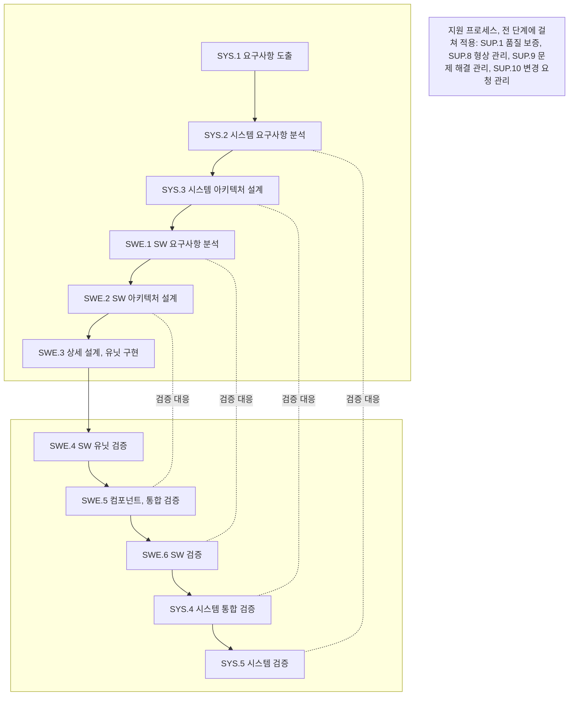

# AutoDevFlow 01. 자동차 시스템 및 SW 개발 업무 분석서

- 문서 버전: v1.0
- 작성일: 2026-11-24
- 상태: 초안 확정, 11장 현업 확인 전

## 문서 개요

이 문서는 자동차 시스템 및 SW 개발 세부 업무를 같은 기준으로 분석하여, 어떤 업무에 어떤 기술(LLM, RAG, 정적 분석, 일반 자동화)을 적용할지와 첫 번째 MVP 범위를 결정하는 근거 문서다. AutoDevFlow 산출물 10종 중 01번에 해당한다.

**분석 범위**는 Automotive SPICE 4.0의 SYS.1\~SYS.5, SWE.1\~SWE.6, SUP.1, SUP.8, SUP.9, SUP.10이다. 관리(MAN), 획득(ACQ), 하드웨어(HWE), 머신러닝(MLE), 검증·확인(VAL.1) 프로세스는 이번 범위에서 제외하고 후속 확장 대상으로 둔다.

**현재 한계**: 실제 완성차·부품사의 업무 데이터는 확보하지 않았다. 따라서 이 문서의 업무 모델은 공식 표준 문서와 공개 자료를 기반으로 구성한 것이며, 11장의 현업 확인을 거쳐 수정한다.

### 근거 수준 표기

| 표기 | 의미 | 예시 |
| --- | --- | --- |
| 공식 | 표준 원문, 제품 공식 문서 | ASPICE 4.0 PAM, 제품 문서 |
| 논문 | 학술 논문, 프리프린트 | 추적성 복원 연구 |
| 현업 | 실무자 인터뷰, 허가받은 업무 자료로 확인 | 11장 확인 결과 |
| 가설 | 작성자가 추정한 내용, 검증 전 | 반복 업무 추정, Pain Point 추정 |

### 미확인 값 처리 원칙

- 반복 빈도와 소요 시간은 현업 확인 전까지 모든 업무에서 **미확인**으로 둔다. 추정 숫자를 채우지 않는다.
- 미확인 항목은 11장의 인터뷰 질문으로 옮겨 확인 대상으로 관리한다.
- Pain Point는 근거가 공식 문서에 있지 않으면 **가설**로 표기한다.

### 업무 ID 체계와 분석 항목 배치

업무 ID는 `T-<프로세스>-<번호>` 형식이다(예: T-SWE1-02는 SWE.1의 두 번째 세부 업무). 모든 업무는 아래 17개 항목으로 분석하며, 한 표에 모두 넣으면 읽을 수 없으므로 항목을 장별로 나누어 기록한다.

| 분석 항목 | 기록 위치 |
| --- | --- |
| 업무 ID, 프로세스와 BP, 업무 목적, 수행 주체 | 3\~5장 업무 표 |
| 입력 산출물, 출력 산출물 | 3\~5장 업무 표, 6장 산출물 분석 |
| 수행 절차 | 3\~5장 프로세스별 설명 |
| 반복 빈도, 소요 시간 | 전 업무 미확인, 11장 확인 대상 |
| Pain Point | 3\~5장 업무 표, 7장 종합 |
| 자동화 가능성, AI 활용 방식 | 3\~5장 업무 표, 8장 기술 매핑 |
| 자동화 위험도, 사람의 개입 | 3\~5장 업무 표 |
| 효과 검증 방법, 구현 우선순위 | 10장 우선순위 평가 |
| 근거 수준 | 모든 표의 근거 열 |

## 01. 프로젝트 배경

자동차 SW 개발의 병목은 산출물을 만드는 일보다 산출물끼리 내용이 맞는지 계속 확인하는 일에 있다는 것이 이 프로젝트의 출발점이다(가설, 11장에서 확인).

### 개발 환경의 문제점

| 문제 | 내용 | 근거 |
| --- | --- | --- |
| 링크와 정합성의 차이 | ASPICE 4.0은 추적 링크가 있다는 것만으로 정보가 서로 일치한다고 볼 수 없다고 명시하며, 추적 체인을 따라 내용이 의미적으로 맞는다는 근거를 요구한다 | 공식 ([itemis 인용](https://www.itemis.com/en/blog/compliance-intelligence/requirements-traceability/aspice-traceability-vs-consistency/)) |
| 도구 분산 | 요구사항은 ALM, 코드는 Git, 시험 결과는 CI·시험 도구, 변경 요청은 이슈 도구에 따로 있어 버전을 맞춰 보기 어렵다 | 가설 |
| 변경의 파급 | 요구사항 하나가 바뀌면 설계, 코드, 시험, 기존 시험 결과까지 다시 확인해야 한다 | 가설 |
| 반복 문서 작업 | 추적 매트릭스, 검증 보고서, 영향도 분석서를 사람이 정리한다 | 가설 |
| 버전 불일치 | 시험이 PASS여도 그 시험이 현재 코드·요구사항 버전에 대한 것인지 따로 확인해야 한다 | 가설 |

### AI 적용 목적

1. 반복적인 문서 작성과 데이터 정리를 자동화한다.
2. 산출물 간 정합성을 검토하고, 변경의 영향을 받는 산출물을 찾는다.
3. 검증 결과가 어떤 버전의 산출물에 대한 것인지 추적할 수 있게 한다.
4. AI 적용 효과를 정확도, 작업 시간, 비용으로 측정해 개발 프로세스에 반영한다.

플랫폼은 자동차 SW를 자동으로 만드는 도구가 아니다. AI 결과는 항상 근거를 갖춘 초안이며, 확정은 엔지니어의 승인을 거친다. 결정론적으로 처리할 수 있는 작업은 AI 대신 일반 소프트웨어로 구현한다.

## 02. 자동차 개발 프로세스

자동차 시스템과 SW는 V-model을 따라 왼쪽에서 요구사항을 구체화하고 오른쪽에서 같은 수준의 검증으로 확인하며, 이 문서는 Automotive SPICE 4.0(PAM v4.0, 2023-11-29)의 프로세스 15개를 업무 분석의 뼈대로 쓴다.

왼쪽 프로세스와 오른쪽 프로세스가 같은 높이에서 짝을 이루며(예: SWE.1 SW 요구사항은 SWE.6 SW 검증으로 확인), 형상 관리와 변경 요청 관리는 모든 단계의 산출물에 걸쳐 적용된다.

**이 문서에서 쓰는 ASPICE 개념**

- **BP(Base Practice)**: 프로세스마다 수행해야 할 기본 활동. 3\~5장의 업무는 BP 단위로 나누었다.
- **정합성과 양방향 추적**: SYS.2\~SYS.5, SWE.1\~SWE.6에 모두 "Ensure consistency and establish bidirectional traceability" BP가 있다. 추적은 링크, 정합성은 그 링크로 이어진 내용이 서로 맞는다는 사실이다.
- **버전 참고**: VDA QMC가 2026-04에 PAM 4.1 프리뷰 문서를 게시했으며, 변경 사항은 산출물 02에서 확인해 반영한다.

## 03. 시스템 개발 업무 분석 (SYS.1\~SYS.5)

시스템 단계에서 AI 효과가 가장 클 것으로 보이는 업무는 비정형 고객 사양서에서 요구를 추출하고 사양 개정판의 변경을 분석하는 일이며, 시스템 아키텍처 설계는 AI 적합성이 낮다(가설). BP 제목은 [ASPICE PAM v4.0](https://vda-qmc.de/wp-content/uploads/2023/12/Automotive-SPICE-PAM-v40.pdf) 원문 기준이다.

위험도는 AI 결과가 틀린 채 검토를 통과했을 때의 영향으로, 높음(하위 산출물·안전에 전파), 중간(재작업 발생), 낮음(사람이 쉽게 발견) 3단계로 표기한다. 수행 주체는 회사마다 다르므로 전부 가설이다.

### 업무 정의

| 업무 ID | 업무 (BP) | 목적 | 수행 주체 | 입력 산출물 | 출력 산출물 |
| --- | --- | --- | --- | --- | --- |
| T-SYS1-01 | 이해관계자 요구 수집 (SYS.1.BP1, BP2) | 고객·법규 요구를 빠짐없이 확보하고 합의 | 요구사항 엔지니어 | 고객 사양서, 법규, 내부 표준 | 이해관계자 요구사항 |
| T-SYS1-02 | 이해관계자 요구 변경 분석 (SYS.1.BP3) | 사양 개정판의 변경을 파악 | 요구사항 엔지니어 | 사양서 구버전·신버전 | 변경 목록, 영향 메모 |
| T-SYS2-01 | 시스템 요구사항 명세·구조화 (SYS.2.BP1, BP2) | 검증 가능한 시스템 요구로 변환 | 시스템 엔지니어 | 이해관계자 요구사항 | 시스템 요구사항 명세서 |
| T-SYS2-02 | 시스템 요구사항 분석 (SYS.2.BP3, BP4) | 모호성, 검증 가능성, 상호 모순, 시스템 컨텍스트 영향 확인 | 시스템 엔지니어 | 시스템 요구사항 | 분석 결과, 수정 요청 |
| T-SYS2-03 | 요구사항 정합성·양방향 추적 (SYS.2.BP5) | 이해관계자 요구와 시스템 요구 연결 | 시스템 엔지니어 | 두 요구사항 집합 | 추적 링크, 정합성 기록 |
| T-SYS3-01 | 시스템 아키텍처 명세 (SYS.3.BP1, BP2) | 구성요소, 인터페이스, 동작 정의 | 시스템 아키텍트 | 시스템 요구사항 | 시스템 아키텍처 |
| T-SYS3-02 | 아키텍처 분석·추적 (SYS.3.BP3, BP4) | 설계 대안 평가, 요구사항 할당 확인 | 시스템 아키텍트 | 아키텍처, 요구사항 | 분석 결과, 추적 링크 |
| T-SYS4-01 | 통합 검증 수단 명세·선정 (SYS.4.BP1, BP2) | 통합 시험 방법 정의 | 통합·검증 엔지니어 | 시스템 아키텍처 | 통합 검증 수단 |
| T-SYS4-02 | 통합 수행·결과 요약 (SYS.4.BP3\~BP5) | 통합 시험 실행, 추적, 보고 | 통합·검증 엔지니어 | 통합 대상, 검증 수단 | 통합 검증 결과 |
| T-SYS5-01 | 시스템 검증 수단 명세·선정 (SYS.5.BP1, BP2) | 시스템 요구별 시험 사양 작성 | 시스템 검증 엔지니어 | 시스템 요구사항 | 시스템 검증 수단 |
| T-SYS5-02 | 시스템 검증 수행·추적·요약 (SYS.5.BP3\~BP5) | 요구사항 충족 여부 확인, 결과 보고 | 시스템 검증 엔지니어 | 통합 시스템, 검증 수단 | 시스템 검증 결과 |

### 자동화 분석

| 업무 ID | Pain Point (가설) | 자동화 가능성 | AI 활용 방식 | 위험도 | 사람의 개입 |
| --- | --- | --- | --- | --- | --- |
| T-SYS1-01 | 분량이 큰 비정형 사양서에서 요구를 수작업으로 추출 | 부분 | LLM 추출·분류 + 원문 위치 인용 | 높음 (누락 전파) | 전수 검토 |
| T-SYS1-02 | 개정판 간 문장 단위 비교와 의미 변경 판별 | 부분 | 구조화 후 diff(일반) + 의미 변경 분류(LLM) | 중간 | 변경 목록 승인 |
| T-SYS2-01 | 요구사항 문장 작성과 ID·속성 정리 반복 | 부분 | LLM 초안 + 템플릿(EARS 등) + ID 규칙 검사(일반) | 중간 | 전수 검토 |
| T-SYS2-02 | 모호한 표현, 단위 누락, 상충 요구를 사람이 눈으로 찾음 | 부분 | LLM(모호성·관계 추출) + 규칙 엔진(모순 비교) | 중간 | 지적 사항 검토 |
| T-SYS2-03 | 링크를 수동으로 만들고 변경 때마다 다시 확인 | 부분 | 임베딩 후보 + LLM 검증, 확정은 승인 | 중간 | 링크 승인 |
| T-SYS3-01 | 구조 결정은 경험·모델 기반(SysML 등) | 낮음 | 모델 기반 설계는 AI 보조 효과 제한적 | 높음 | 사람 주도 |
| T-SYS3-02 | 요구사항이 아키텍처 요소에 빠짐없이 할당됐는지 확인 | 부분 | 링크 커버리지 계산(일반) + 할당 누락 후보(LLM) | 중간 | 검토 |
| T-SYS4-01 | 통합 시험 사양 작성 반복 | 부분 | LLM 초안 + 인터페이스 목록 기반 생성 | 중간 | 검토 |
| T-SYS4-02 | 시험 환경(HIL 등) 실행과 결과 정리 | 전체(실행), 부분(보고) | 실행·수집은 일반 자동화, 요약은 LLM | 낮음 | 결과 확인 |
| T-SYS5-01 | 요구사항별 시험 사양 작성 반복 | 부분 | LLM + 시험 설계 기법(경계값, 동등 분할) | 중간 | 검토 |
| T-SYS5-02 | 결과와 요구사항 버전 대조, 보고서 작성 | 부분 | 버전 일치 검사·커버리지(일반) + 보고서 초안(LLM) | 중간 | 보고서 승인 |

현재 수행 절차(가설): 사양서를 읽고 ALM에 요구사항을 입력한 뒤 리뷰 회의로 합의하고, 링크는 ALM에서 수동으로 연결하며, 검증은 HIL·차량 시험 후 결과를 보고서로 정리한다. 11장 Q1\~Q3으로 확인한다.

## 04. SW 개발 업무 분석 (SWE.1\~SWE.6)

SW 단계는 모든 프로세스에 "정합성 확보와 양방향 추적" BP가 있어(SWE.1.BP5, SWE.2.BP4, SWE.3.BP4, SWE.4.BP4, SWE.5.BP6, SWE.6.BP4), 추적·정합성 자동화의 적용 범위가 가장 넓다(공식). 코드와 시험 결과처럼 기계가 읽을 수 있는 산출물이 많아 결정론적 도구의 비중도 높다.

### 업무 정의

| 업무 ID | 업무 (BP) | 목적 | 수행 주체 | 입력 산출물 | 출력 산출물 |
| --- | --- | --- | --- | --- | --- |
| T-SWE1-01 | SW 요구사항 명세·구조화 (SWE.1.BP1, BP2) | 시스템 요구를 SW가 만족할 요구로 변환 | SW 요구사항 엔지니어 | 시스템 요구사항, 시스템 아키텍처 | SW 요구사항 명세서 |
| T-SWE1-02 | 요구사항 ID·속성 무결성 관리 (SWE.1.BP2 관련) | ID 중복, 필수 속성 누락 방지 | SW 요구사항 엔지니어 | SW 요구사항 | 무결성 점검 결과 |
| T-SWE1-03 | SW 요구사항 분석 (SWE.1.BP3) | 모호성, 검증 가능성, 상호 모순 확인 | SW 요구사항 엔지니어 | SW 요구사항 | 분석 결과, 수정 요청 |
| T-SWE1-04 | 운영 환경 영향 분석 (SWE.1.BP4) | 요구가 실행 환경(ECU, 타 SW)에 주는 영향 파악 | SW 요구사항 엔지니어 | SW 요구사항, 플랫폼 정보 | 영향 분석 결과 |
| T-SWE1-05 | SW 요구사항 정합성·추적 (SWE.1.BP5) | 시스템 요구·아키텍처와 SW 요구 연결 | SW 요구사항 엔지니어 | 시스템·SW 요구사항 | 추적 링크, 정합성 기록 |
| T-SWE2-01 | SW 아키텍처 명세 (SWE.2.BP1, BP2) | 컴포넌트, 인터페이스, 동적 동작 정의 | SW 아키텍트 | SW 요구사항 | SW 아키텍처 |
| T-SWE2-02 | SW 아키텍처 분석·추적 (SWE.2.BP3, BP4) | 설계 대안 평가, 요구 할당 확인 | SW 아키텍트 | 아키텍처, SW 요구사항 | 분석 결과, 추적 링크 |
| T-SWE3-01 | 상세 설계 명세 (SWE.3.BP1, BP2) | 유닛의 구조, 상태, 로직 정의 | SW 개발자 | SW 아키텍처 | 상세 설계(상태도 등) |
| T-SWE3-02 | SW 유닛 개발 (SWE.3.BP3) | 상세 설계대로 코드 구현 | SW 개발자 | 상세 설계 | 소스코드 |
| T-SWE3-03 | 설계·코드 정합성·추적 (SWE.3.BP4) | 설계와 코드의 일치 확인 | SW 개발자 | 상세 설계, 소스코드 | 추적 링크, 정합성 기록 |
| T-SWE4-01 | 단위 검증 수단 명세·선정 (SWE.4.BP1, BP2) | 단위 시험 케이스와 검증 방법 정의 | SW 개발자, 검증 엔지니어 | 상세 설계 | 단위 검증 수단(TC) |
| T-SWE4-02 | 정적 검증·코드 리뷰 (SWE.4.BP3) | 코딩 규칙 위반, 결함 패턴 탐지 | SW 개발자, 리뷰어 | 소스코드, 코딩 규칙 | 정적 분석 결과, 리뷰 기록 |
| T-SWE4-03 | 단위 시험 실행·커버리지 (SWE.4.BP3) | TC 실행과 커버리지 측정 | SW 개발자, 검증 엔지니어 | 소스코드, TC | 시험 결과, 커버리지 |
| T-SWE4-04 | 검증 수단·유닛·결과 추적 (SWE.4.BP4) | 유닛과 TC, TC와 결과 연결 | 검증 엔지니어 | 상세 설계, TC, 결과 | 추적 링크 |
| T-SWE4-05 | 단위 검증 결과 요약 (SWE.4.BP5) | 결과 보고와 공유 | 검증 엔지니어 | 시험 결과 | 단위 검증 보고서 |
| T-SWE5-01 | 통합·컴포넌트 검증 수단 명세 (SWE.5.BP1\~BP3) | 통합 시험과 컴포넌트 동작 시험 정의 | 검증 엔지니어 | SW 아키텍처 | 통합 검증 수단 |
| T-SWE5-02 | 통합 수행·컴포넌트 검증 (SWE.5.BP4, BP5) | 유닛 통합과 인터페이스 동작 확인 | 검증 엔지니어 | 유닛, 검증 수단 | 통합 검증 결과 |
| T-SWE5-03 | 통합 검증 추적·요약 (SWE.5.BP6, BP7) | 아키텍처·검증 수단·결과 연결 | 검증 엔지니어 | 아키텍처, 결과 | 추적 링크, 보고서 |
| T-SWE6-01 | SW 검증 수단 명세·선정 (SWE.6.BP1, BP2) | SW 요구별 검증 시험 정의 | 검증 엔지니어 | SW 요구사항 | SW 검증 수단 |
| T-SWE6-02 | 통합 SW 검증 수행 (SWE.6.BP3) | 요구사항 충족 여부 시험 | 검증 엔지니어 | 통합 SW, 검증 수단 | SW 검증 결과 |
| T-SWE6-03 | 요구사항·검증 결과 추적·요약 (SWE.6.BP4, BP5) | 요구사항 커버리지와 결과 보고 | 검증 엔지니어 | SW 요구사항, 결과 | 추적 링크, 검증 보고서 |

### 자동화 분석

| 업무 ID | Pain Point (가설) | 자동화 가능성 | AI 활용 방식 | 위험도 | 사람의 개입 |
| --- | --- | --- | --- | --- | --- |
| T-SWE1-01 | 시스템 요구를 SW 관점으로 다시 쓰는 반복 작업 | 부분 | LLM 초안 + 템플릿 | 중간 | 전수 검토 |
| T-SWE1-02 | 수백 개 요구사항의 ID·속성 누락을 수작업으로 점검 | 전체 | 일반 알고리즘(중복·필수값 검사), 의미 중복은 임베딩 | 낮음 | 불필요(의미 중복만 검토) |
| T-SWE1-03 | 모호한 표현, 단위 누락, 요구 간 모순(예: ON/OFF 임계값 역전) 발견이 리뷰어 역량에 의존 | 부분 | LLM(관계·수치 추출) + 규칙 엔진(비교 판정) | 중간 | 지적 사항 검토 |
| T-SWE1-04 | 타 SW·자원에 대한 영향 파악이 경험 의존 | 낮음 | RAG(플랫폼 문서 참조) 보조 | 높음 | 사람 주도 |
| T-SWE1-05 | 링크 수동 생성, 개정 때마다 재확인 | 부분 | 임베딩 후보 + LLM 검증, 확정은 승인 | 중간 | 링크 승인 |
| T-SWE2-01 | AUTOSAR 등 모델 기반 설계, 텍스트 초안의 가치 제한적 | 낮음 | 인터페이스 정의 초안(LLM)으로 범위 축소 | 높음 | 사람 주도 |
| T-SWE2-02 | 요구사항 할당 누락 확인 | 부분 | 커버리지 계산(일반) + 누락 후보(LLM) | 중간 | 검토 |
| T-SWE3-01 | 상태도·로직 문서 작성과 코드 변경 후 문서 갱신 누락 | 부분 | 상태도 초안(LLM, PlantUML) | 중간 | 검토 |
| T-SWE3-02 | 반복적인 보일러플레이트 코드 | 부분 | 코드 생성 보조(LLM), 안전 관련 코드는 제외 | 높음 | 전수 리뷰 |
| T-SWE3-03 | 설계에 없는 코드, 코드에 없는 설계 발견이 어려움 | 부분 | AST·호출 그래프(일반) + 의미 대조(LLM) | 중간 | 검토 |
| T-SWE4-01 | 경계값·예외 케이스 설계 누락 | 부분 | LLM + 시험 설계 기법(경계값, 동등 분할) | 중간 | 검토 |
| T-SWE4-02 | 정적 분석 경고가 많아 분류·해석에 시간 소모 | 부분 | 규칙 검사는 정적 분석 도구, 경고 설명·수정 제안은 LLM | 중간 | 수정 승인 |
| T-SWE4-03 | 실행·커버리지 수집은 이미 자동화된 경우가 많음 | 전체 | 시험 프레임워크·CI(일반), AI 불필요 | 낮음 | 실패 확인 |
| T-SWE4-04 | 결과가 어느 코드·TC 버전에 대한 것인지 연결 수작업 | 전체 | 실행 메타데이터 기록·버전 일치 검사(일반) | 중간 | 불필요 |
| T-SWE4-05 | 보고서 양식 채우기 반복 | 부분 | 집계(일반) + 요약 문장(LLM) | 낮음 | 승인 |
| T-SWE5-01 | 인터페이스별 통합 시험 사양 작성 반복 | 부분 | 인터페이스 목록 기반 초안(LLM) | 중간 | 검토 |
| T-SWE5-02 | 통합 환경 구성과 실행 | 전체(실행) | CI·빌드 자동화(일반), 실패 원인 설명(LLM + 로그) | 낮음 | 실패 확인 |
| T-SWE5-03 | 추적·보고 수작업 | 전체 | 그래프 집계(일반) | 낮음 | 승인 |
| T-SWE6-01 | 요구사항별 검증 시험 설계 반복 | 부분 | LLM + 시험 설계 기법 | 중간 | 검토 |
| T-SWE6-02 | 시험 환경 실행과 판정 | 전체 | 시험 프레임워크(일반) | 낮음 | 실패 확인 |
| T-SWE6-03 | PASS 결과가 현재 요구사항을 실제로 충족하는지, 버전이 맞는지 확인 | 부분 | 버전 일치·커버리지(일반) + 충족도 검토(LLM + 근거) | 높음 | 판정 승인 |

현재 수행 절차(가설): SW 요구사항과 설계는 ALM·모델링 도구에서, 코드는 Git에서, 단위·통합 시험은 CI·시험 도구에서 관리하고, 도구 사이의 추적과 보고서는 사람이 연결한다. 11장 Q4\~Q7로 확인한다.

## 05. 개발 지원 업무 분석 (SUP.1, SUP.8, SUP.9, SUP.10)

지원 프로세스 중 플랫폼의 핵심 대상은 SUP.10.BP2(변경 요청 분석·평가), SUP.10.BP5(변경 구현 확인), SUP.8.BP7(완전성과 일관성 확보)이다. 요구사항과 시험이 연결돼 있어도 서로 다른 버전이면 그 검증 결과를 신뢰할 수 없으므로, 형상 관리와 변경 관리는 추적성 자동화의 전제 조건이다.

**범위 제한**: SUP.10의 변경 요청 평가에는 비용, 일정, 자원, 위험 평가가 포함될 수 있다. 이 플랫폼은 그중 **기술적 변경 영향도 분석만** 지원하며, SUP.10 전체를 충족한다고 주장하지 않는다.

### 업무 정의

| 업무 ID | 업무 (BP) | 목적 | 수행 주체 | 입력 산출물 | 출력 산출물 |
| --- | --- | --- | --- | --- | --- |
| T-SUP1-01 | 품질 보증 기준 정의 (SUP.1.BP2) | 산출물·활동의 품질 기준 수립 | 품질 담당자 | 표준, 프로젝트 정책 | QA 기준, 체크리스트 |
| T-SUP1-02 | 산출물 품질 보증 (SUP.1.BP3) | 산출물이 기준을 만족하는지 확인 | 품질 담당자 | 각 산출물, QA 기준 | QA 기록, 부적합 목록 |
| T-SUP1-03 | 부적합 해결·에스컬레이션 (SUP.1.BP6, BP7) | 부적합 조치 추적 | 품질 담당자 | 부적합 목록 | 조치 기록 |
| T-SUP8-01 | 형상 항목 식별·속성 정의 (SUP.8.BP1, BP2) | 관리할 산출물과 속성 확정 | 형상 관리자 | 산출물 목록 | 형상 항목 목록 |
| T-SUP8-02 | 변경 통제 (SUP.8.BP4) | 승인된 변경만 반영 | 형상 관리자, 개발자 | 변경분, CR | 변경 이력 |
| T-SUP8-03 | 베이스라인 수립 (SUP.8.BP5) | 시점별 산출물 버전 조합 고정 | 형상 관리자 | 형상 항목 버전 | 베이스라인 |
| T-SUP8-04 | 형상 상태 요약 (SUP.8.BP6) | 현재 형상 상태 공유 | 형상 관리자 | 변경 이력, 베이스라인 | 형상 상태 보고 |
| T-SUP8-05 | 베이스라인 완전성·일관성 확인 (SUP.8.BP7) | 베이스라인 안 산출물 버전이 서로 맞는지 확인 | 형상 관리자 | 베이스라인, 추적 링크 | 일관성 확인 기록 |
| T-SUP9-01 | 문제 식별·기록 (SUP.9.BP1) | 결함을 재현 가능하게 기록 | 검증 엔지니어 | 실패 로그, 시험 결과 | 결함 보고서 |
| T-SUP9-02 | 원인·영향 분석 (SUP.9.BP2) | 결함 원인과 영향 범위 파악 | SW 개발자 | 결함 보고서, 코드, 로그 | 원인 분석 결과 |
| T-SUP9-03 | 문제 추적·종결·보고 (SUP.9.BP5\~BP7) | 해결까지 추적 | 프로젝트 담당자 | 결함 목록 | 상태 보고 |
| T-SUP10-01 | 변경 요청 식별·기록 (SUP.10.BP1) | 변경 내용을 CR로 구조화 | 요청자, 담당 엔지니어 | 변경 요구 | CR |
| T-SUP10-02 | 변경 요청 분석·평가 (SUP.10.BP2) | 영향받는 산출물과 재검증 대상 파악 | 담당 엔지니어 | CR, 추적 링크, 산출물 | 영향도 분석서 |
| T-SUP10-03 | 구현 전 승인 (SUP.10.BP3) | 분석 결과로 승인 여부 결정 | 변경 승인자(CCB 등) | CR, 영향도 분석서 | 승인 기록 |
| T-SUP10-04 | CR 양방향 추적 (SUP.10.BP4) | CR과 수정된 산출물 연결 | 담당 엔지니어 | CR, 변경 산출물 | 추적 링크 |
| T-SUP10-05 | 변경 구현 확인 (SUP.10.BP5) | 변경이 모든 산출물에 반영됐는지 확인 | 담당 엔지니어, 검증 엔지니어 | CR, 수정 산출물, 회귀 시험 결과 | 구현 확인 기록 |
| T-SUP10-06 | CR 종결 추적 (SUP.10.BP6) | 종결까지 상태 관리 | 프로젝트 담당자 | CR 목록 | 상태 보고 |

### 자동화 분석

| 업무 ID | Pain Point (가설) | 자동화 가능성 | AI 활용 방식 | 위험도 | 사람의 개입 |
| --- | --- | --- | --- | --- | --- |
| T-SUP1-01 | 표준·정책을 체크리스트로 옮기는 작업 | 부분 | 규칙 정의는 사람, 초안은 LLM + RAG | 중간 | 승인 |
| T-SUP1-02 | 체크리스트 항목을 산출물마다 수작업으로 대조 | 부분 | 형식 규칙(일반) + 내용 규칙(LLM) | 중간 | 부적합 판정 검토 |
| T-SUP1-03 | 조치 현황 추적 | 전체 | 워크플로 엔진(일반) | 낮음 | 불필요 |
| T-SUP8-01 | 도구마다 버전 체계가 다름(Git commit, ALM revision) | 전체 | 공통 식별자 매핑(일반) | 낮음 | 초기 설정 |
| T-SUP8-02 | 승인 없는 변경 탐지 | 전체 | CR-커밋 연결 검사(일반) | 낮음 | 예외 검토 |
| T-SUP8-03 | 도구별 버전을 모아 스냅샷 작성 | 전체 | 버전 조합 스냅샷(일반) | 낮음 | 승인 |
| T-SUP8-04 | 상태 보고 작성 반복 | 전체 | 집계(일반) | 낮음 | 불필요 |
| T-SUP8-05 | 시험 결과가 이전 코드·요구사항 버전에 대한 것인지 확인이 어려움 | 전체 | 버전 일치 검사, STALE 판정(일반) | 중간 | 재사용 승인 |
| T-SUP9-01 | 실패 로그를 보고서 양식으로 옮기는 작업 | 부분 | 로그 파싱(일반) + 보고서 초안(LLM) | 낮음 | 검토 |
| T-SUP9-02 | 로그·코드·요구사항을 오가며 원인 추적 | 부분 | LLM + 실행 로그 + 추적 그래프 | 중간 | 원인 확정 |
| T-SUP9-03 | 상태 추적 | 전체 | 이슈 도구 연동(일반) | 낮음 | 불필요 |
| T-SUP10-01 | 자유 형식 변경 요구를 구조화 | 부분 | LLM(변경 대상·전후 값 추출) | 낮음 | 검토 |
| T-SUP10-02 | 링크가 없는 산출물, 의미적 영향(예: 히스테리시스 역전)을 놓침 | 부분 | 그래프 탐색 + 검색·AST + LLM 의미 판단 + 규칙 엔진 | 높음 | 영향 목록 승인 |
| T-SUP10-03 | 분석 근거가 흩어져 있어 승인 판단이 느림 | 불가능(판단) | 근거 정리만 지원 | 높음 | 사람이 결정 |
| T-SUP10-04 | CR과 커밋·산출물 연결 수작업 | 전체 | 커밋 메시지·API 연동(일반) | 낮음 | 불필요 |
| T-SUP10-05 | 미반영 산출물·잘못된 수정 발견이 늦음 | 부분 | 회귀 시험(일반) + 정합성 검사(LLM + 규칙) + 버전 확인(일반) | 높음 | 최종 검토 |
| T-SUP10-06 | 상태 추적 | 전체 | 워크플로 엔진(일반) | 낮음 | 불필요 |

현재 수행 절차(가설): CR은 이슈 도구·ALM에 등록하고, 영향도는 ALM의 링크와 담당자 경험으로 판단하며, 구현 확인은 회귀 시험 결과와 리뷰로 종결한다. 11장 Q8\~Q10으로 확인한다.

## 06. 개발 산출물 분석

산출물은 원본 관리 시스템이 서로 달라 버전 식별 방법도 다르므로, 플랫폼은 Git commit을 강제하지 않고 `source_system`, `external_id`, `source_revision`, `content_hash` 4개 필드를 공통 식별자로 쓴다. 상세 스키마는 산출물 06(데이터 모델)에서 확정한다.

### 산출물별 생성·사용 업무와 버전 식별

| 산출물 | 생성 업무 | 사용 업무 | 원본 관리 시스템 (가설) | 버전 식별 |
| --- | --- | --- | --- | --- |
| 이해관계자 요구사항 | T-SYS1-01 | T-SYS2-01, T-SYS2-03 | ALM | Item ID + Revision |
| 시스템 요구사항 | T-SYS2-01 | T-SYS3-01, T-SWE1-01, T-SYS5-01 | ALM | Item ID + Revision |
| SW 요구사항 | T-SWE1-01 | T-SWE2-01, T-SWE6-01, T-SUP10-02 | ALM | Item ID + Revision |
| SW 아키텍처 | T-SWE2-01 | T-SWE3-01, T-SWE5-01 | ALM 또는 모델링 도구 | Revision |
| 상세 설계 | T-SWE3-01 | T-SWE3-02, T-SWE4-01 | Git 또는 ALM | Commit 또는 Revision |
| 소스코드 | T-SWE3-02 | T-SWE4-02, T-SWE4-03, T-SUP9-02 | Git | Commit SHA + 파일 경로 |
| 단위·통합·SW 검증 수단(TC) | T-SWE4-01, T-SWE5-01, T-SWE6-01 | T-SWE4-03, T-SWE6-02 | Git 또는 시험 관리 도구 | Commit 또는 TC Revision |
| 시험 결과 | T-SWE4-03, T-SWE6-02 | T-SWE6-03, T-SUP9-01 | CI 또는 시험 도구 | Execution ID |
| 변경 요청(CR) | T-SUP10-01 | T-SUP10-02\~06 | 이슈 도구 또는 ALM | Issue ID + Revision |
| 결함 보고서 | T-SUP9-01 | T-SUP9-02, T-SUP10-01 | 이슈 도구 | Issue ID + Revision |
| 베이스라인 | T-SUP8-03 | T-SUP8-05, T-SWE6-03 | 형상 관리 도구 | Baseline ID |

### 추적 관계 유형

모든 링크를 RELATED\_TO 하나로 두면 영향 전파 규칙을 정할 수 없으므로 유형을 나눈다. 링크는 양쪽 끝 산출물의 버전을 함께 저장한다(예: REQ-SW-003@v2 → TC-003@v1).

| 링크 유형 | 의미 | 예시 |
| --- | --- | --- |
| DERIVES\_FROM | 상위 요구사항에서 파생 | SW 요구 → 시스템 요구 |
| SATISFIES | 설계·구현이 요구사항을 충족하도록 할당됨 | 아키텍처 요소 → SW 요구 |
| IMPLEMENTS | 상세 설계를 코드로 구현 | 코드 함수 → 상세 설계 |
| VERIFIES | 시험이 요구사항·설계를 검증 | TC → SW 요구 |
| DEPENDS\_ON | 다른 산출물에 의존 | 컴포넌트 → 인터페이스 |
| EXECUTED\_AS | 시험 케이스와 실행 결과 연결 | TC → Execution |
| CHANGES | 변경 요청과 수정된 산출물 연결 | CR → SW 요구, 코드 |

SATISFIES라는 **관계가 있다는 것**과 검증 결과가 **SATISFIED라는 것**은 별개다. 전자는 링크의 의미이고, 후자는 근거를 갖춘 판정이다.

### 상태 체계

아래 다섯 상태는 서로 독립적으로 저장하고, "검증 완료" 같은 종합 판정은 정책 엔진의 명시적 규칙으로 계산한다(예: SATISFIED 그리고 VALID 그리고 PASS 그리고 APPROVED).

| 상태 구분 | 가능한 값 |
| --- | --- |
| 영향도 분석 | IMPACTED / NOT\_IMPACTED / UNCERTAIN |
| 요구사항 충족도 | SATISFIED / UNSATISFIED / UNCERTAIN |
| 근거 유효성 | VALID / STALE / MISSING |
| 검토 상태 | PROPOSED / APPROVED / REJECTED |
| 시험 실행 | PASS / FAIL / NOT\_RUN / ERROR |

시험 결과는 버전이 바뀌어도 과거 베이스라인에 대한 유효한 증거로 남기고, 신규 베이스라인 재사용 여부는 CURRENT / STALE / REVALIDATED / SUPERSEDED로 따로 관리한다. MVP는 관련 버전이 바뀌면 보수적으로 STALE 처리한다.

## 07. 반복 업무 및 Pain Point

3\~5장의 Pain Point 49건은 11개 유형으로 묶이며, 그중 P1\~P4는 "산출물 간 연결과 버전"이라는 같은 원인에서 나온다. 하나를 해결하는 기반(버전을 포함한 추적 그래프)이 네 유형에 모두 쓰이므로, 이 묶음이 12장 MVP 선정의 출발점이 된다. 모든 항목의 빈도와 소요 시간은 미확인이다.

| ID | Pain Point 유형 | 성격 | 관련 업무 | 근거 |
| --- | --- | --- | --- | --- |
| P1 | 추적 링크 생성·유지 수작업 | 시간 소모 | T-SYS2-03, T-SWE1-05, T-SWE2-02, T-SWE3-03, T-SWE4-04, T-SWE5-03, T-SWE6-03 | 가설 |
| P2 | 링크는 있으나 내용이 서로 맞지 않음 | 오류 | T-SWE1-05, T-SWE3-03, T-SWE6-03 | 공식 (ASPICE 4.0 정합성 개념) |
| P3 | 변경 시 영향받는 산출물 누락, 의미적 모순 미발견 | 오류 | T-SYS1-02, T-SUP10-02, T-SUP10-05 | 가설 |
| P4 | 이전 버전에 대한 시험 결과를 현재 검증 결과로 사용 | 오류 | T-SUP8-05, T-SWE4-04, T-SWE6-03 | 가설 |
| P5 | 비정형 문서에서 요구 추출, 요구사항 문장 작성 | 시간 소모 | T-SYS1-01, T-SYS2-01, T-SWE1-01 | 가설 |
| P6 | 요구사항 품질 결함(모호성, 단위 누락, 모순) | 오류 | T-SYS2-02, T-SWE1-02, T-SWE1-03 | 가설 |
| P7 | 경계값·예외 시험 케이스 누락 | 오류 | T-SYS5-01, T-SWE4-01, T-SWE6-01 | 가설 |
| P8 | 정적 분석 경고의 분류·해석 | 시간 소모 | T-SWE4-02 | 가설 |
| P9 | 보고서·상태 보고 양식 채우기 | 수작업 | T-SYS5-02, T-SWE4-05, T-SUP8-04 | 가설 |
| P10 | 로그·코드·요구사항을 오가는 결함 원인 분석 | 시간 소모 | T-SUP9-01, T-SUP9-02 | 가설 |
| P11 | 도구 간 데이터 이동과 식별자 대조 | 수작업 | T-SUP8-01, T-SUP8-03, T-SUP10-04 | 가설 |

P2만 공식 근거를 가지며, 나머지 10개 유형은 11장 현업 확인에서 우선 검증할 대상이다.

## 08. AI 적용 가능성 분석

LLM이 필요한 곳은 비정형 자연어를 해석하거나 의미를 판단하는 단계뿐이며, 결정론적으로 처리할 수 있는 비교, 탐색, 실행, 버전 확인은 일반 소프트웨어로 구현한다. 모든 기능에 LLM을 쓰면 신뢰성이 떨어지고 비용이 늘기 때문이다.

### 업무 유형별 권장 구현 방식

| 업무 유형 | 권장 방식 | 적용 업무 |
| --- | --- | --- |
| 비정형 요구·변경 요청 추출 | LLM | T-SYS1-01, T-SUP10-01 |
| 요구사항 모호성 분석 | LLM + 규칙 | T-SYS2-02, T-SWE1-03 |
| 요구사항 ID 중복, 필수 속성 검사 | 일반 알고리즘 | T-SWE1-02 |
| 요구사항 의미 중복 검사 | 임베딩 유사도 | T-SWE1-02 |
| 코드 구조 분석 | AST, 정적 분석 | T-SWE3-03 |
| 코딩 규칙 검사 | 정적 분석 도구 | T-SWE4-02 |
| 추적 링크 후보 탐색 | BM25·임베딩 + AST·호출 그래프 + LLM 검증 | T-SYS2-03, T-SWE1-05, T-SWE3-03 |
| 승인된 링크의 영향도 분석 | 그래프 탐색 알고리즘 | T-SUP10-02 |
| 변경 내용 감지 (무엇이 바뀌었나) | diff 알고리즘 | T-SYS1-02, T-SUP10-02 |
| 변경의 의미적 영향, 산출물 간 모순 | LLM(관계·수치 추출) + 규칙 엔진(판정) | T-SWE1-03, T-SUP10-02, T-SUP10-05 |
| 시험 케이스 초안 작성 | LLM + 시험 설계 기법 | T-SYS5-01, T-SWE4-01, T-SWE6-01 |
| 시험 실행 및 결과 판정 | 시험 프레임워크 | T-SWE4-03, T-SWE6-02 |
| 버전 일치, STALE 판정 | 일반 알고리즘 | T-SWE4-04, T-SUP8-05 |
| 실패 원인 설명 | LLM + 실행 로그 | T-SUP9-02 |
| 기술 문서 검색 | RAG | T-SWE1-04, T-SUP1-01 |
| 보고서 작성 | 집계(일반) + 요약(LLM) | T-SYS5-02, T-SWE4-05 |
| API 연계, 반복 작업 | 일반 프로그램, 워크플로 엔진 | T-SUP8-01, T-SUP10-04 |

### AI 출력에 적용할 원칙

1. LLM 출력은 승인된 데이터에 직접 쓰지 않고 항상 PROPOSED 상태로 들어간다.
2. 근거가 없거나 부족한 판정은 UNCERTAIN으로 처리한다.
3. 존재하지 않는 코드 위치나 버전이 맞지 않는 근거를 제시한 판정은 거부한다.
4. 모순 판정과 같은 최종 비교는 규칙 엔진이 수행하고, LLM은 비교할 관계를 추출하는 역할만 맡는다.

### 근거 유형별 한계

근거가 있다는 것과 검증되었다는 것은 다르다. 예를 들어 `if (lux < LIGHT_ON_THRESHOLD)` 코드를 정확히 인용해도, 그 함수가 실제로 호출되는지나 시험이 그 조건을 확인했는지는 알 수 없다. 따라서 판정에는 근거 유형을 함께 기록한다.

| 근거 유형 | 확인 가능한 내용 | 한계 |
| --- | --- | --- |
| 문서 근거 | 요구사항과 설계의 내용 | 실제 동작 확인 불가 |
| 코드 근거 | 구현 로직의 존재 | 실행 가능성 미보장 |
| 구조적 근거 | 호출 관계, 데이터 흐름 | 실제 실행 경로와 다를 수 있음 |
| 실행 근거 | 특정 조건에서의 실행 결과 | 시험 범위 밖 동작은 미확인 |
| 엔지니어 검토 | 지정된 범위에 대한 승인 | 검토 범위·판단 오류 가능 |

## 09. 기존 개발 도구 분석

요구사항 품질 검사, 시험 케이스 생성, 추적 링크 제안, 영향도 분석은 주요 상용 ALM이 이미 AI 기능으로 제공하므로, AutoDevFlow는 이를 대체하는 도구가 아니라 ALM과 연계하는 검증 계층으로 포지셔닝한다. 상세 비교는 산출물 02(기존 솔루션 및 선행 연구 분석서)에서 다룬다.

| 범주 | 도구 | 확인된 AI·자동화 기능 | 관련 업무 | 근거 |
| --- | --- | --- | --- | --- |
| ALM | [Siemens Polarion](https://www.siemens.com/en-us/products/polarion/industrial-ai/) | INCOSE 기준 요구사항 품질 검사와 개선안 제시, 의미·직접 유사도 분석으로 중복·관련 항목 탐색 | T-SWE1-02, T-SWE1-03 | 공식 |
| ALM | [PTC Codebeamer AI](https://www.ptc.com/en/products/codebeamer/codebeamer-ai) | Requirements Assistant, Test Case Assistant(요구사항에서 TC 생성, Verifies 링크 저장, 요구사항 변경 시 생성 TC를 suspect 표시) | T-SWE1-01, T-SWE6-01 | 공식 ([도움말](https://support.ptc.com/help/codebeamer_ai/en/codebeamer/test_assistant/1.1/tca_ConsiderationsWhenGeneratingAndSavingTestCase.html)) |
| ALM | [Jama Connect](https://www.jamasoftware.com/solutions/requirements-traceability) | AI 기반 관계 추천(Relationship Discovery), AI 보조 영향도 분석, suspect link, MCP 연동 | T-SWE1-05, T-SUP10-02 | 공식 ([데모](https://www.jamasoftware.com/video/relationship-discover-jama-connect-demo/)) |
| 코드 저장소 | Git (GitHub, GitLab) | 버전 관리, PR 리뷰, API | T-SWE3-02, T-SUP8-02 | 산출물 02에서 확인 |
| CI | GitHub Actions, Jenkins 등 | 빌드·시험 자동 실행, 실행 기록 | T-SWE4-03, T-SWE5-02 | 산출물 02에서 확인 |
| 시험 | GoogleTest, Unity(C), HIL 장비 | 단위·통합·시스템 시험 실행과 판정 | T-SWE4-03, T-SWE6-02, T-SYS4-02 | 산출물 02에서 확인 |
| 정적 분석 | cppcheck(MISRA 애드온), 상용 도구 | 코딩 규칙·결함 패턴 검사 | T-SWE4-02 | 산출물 02에서 확인 |
| 이슈 관리 | Jira | CR·결함 등록과 워크플로, API | T-SUP9-01, T-SUP10-01 | 산출물 02에서 확인 |
| PLM | Teamcenter, Windchill 등 | 하드웨어·부품 중심 데이터 관리 | 범위 밖 | 가설 |

### 기존 도구와 겹치지 않는 지점 (후보)

아래는 "기존 도구에 없다"는 주장이 아니라, 산출물 02에서 확인할 차별화 후보다.

- 변경 후 충족도 판정에 **버전이 일치하는 실행 근거**를 결합하는 검증 워크플로
- 도구마다 다른 버전 체계(ALM revision, Git commit, CI execution)를 하나의 베이스라인으로 묶는 형상 일관성 검사
- 자연어 요구사항에서 관계를 추출하고 규칙 엔진으로 판정하는 의미적 모순 검사(예: ON/OFF 임계값 역전)

## 10. 자동화 우선순위 평가

세부 업무 49개를 기능 후보 13개로 묶어 평가한 결과, F1\~F5(변경 영향도, 변경 후 검증, 버전 일관성, 링크 후보 탐색, 시험 결과 연동)를 MVP로 선정한다. 다섯 기능은 하나의 변경 검증 워크플로를 이루며, 평가 값은 작성자 판단(가설)이다.

평가 기준: **효과**는 연결된 Pain Point의 수와 오류 영향, **난이도**는 1인 구현 부담, **위험**은 오류가 검토를 통과했을 때의 영향, **검증 가능성**은 정답 데이터를 만들어 정량 평가할 수 있는 정도다.

| ID | 기능 후보 | 포함 업무 | Pain Point | 효과 | 난이도 | 위험 | 검증 가능성 | 효과 검증 방법 | 우선순위 |
| --- | --- | --- | --- | --- | --- | --- | --- | --- | --- |
| F1 | 변경 전 영향도 분석 | T-SYS1-02, T-SUP10-01, T-SUP10-02 | P3 | 높음 | 높음 | 높음 | 높음 | 영향 산출물 Precision·Recall·F1, 링크 누락률별 비교, 비교군 B0\~B4 대비 | MVP |
| F2 | 변경 후 정합성·구현 확인 | T-SUP10-05, T-SWE6-03 | P2, P3 | 높음 | 높음 | 높음 | 높음 | 미반영·오류 탐지율과 오탐률, 판정의 근거 유효성 | MVP |
| F3 | 버전·베이스라인 일관성 검사 | T-SUP8-03, T-SUP8-05, T-SWE4-04 | P4, P11 | 높음 | 중간 | 중간 | 높음 | STALE 판정 정확도(결정론적, 단위 시험으로 확인) | MVP |
| F4 | 추적 링크 후보 탐색 | T-SWE1-05, T-SWE3-03 | P1, P2 | 높음 | 중간 | 중간 | 높음 | 링크 Precision@K, Recall | MVP |
| F5 | 시험 실행·결과 수집 연동 | T-SWE4-03, T-SWE6-02 | P4 | 중간 | 낮음 | 낮음 | 높음 | 수집 성공률, 실행 메타데이터 완전성 | MVP |
| F6 | 요구사항 품질·모순 검사 | T-SYS2-02, T-SWE1-02, T-SWE1-03 | P6 | 높음 | 낮음 | 중간 | 중간 | 결함 탐지 Precision·Recall(라벨 대비) | 모순 검사만 MVP, 나머지 후속(02) |
| F7 | 시험 케이스 초안 생성 | T-SYS5-01, T-SWE4-01, T-SWE6-01 | P7 | 높음 | 중간 | 중간 | 중간 | 요구사항 커버리지, 경계값 포함률, 중복률, 작성 시간 | 후속(04) |
| F8 | 코드 리뷰·정적 분석 해석 | T-SWE4-02 | P8 | 중간 | 중간 | 중간 | 중간 | 경고 분류 정확도, 처리 시간 | 후속(03) |
| F9 | 실패 원인 분석 | T-SUP9-01, T-SUP9-02 | P10 | 중간 | 중간 | 중간 | 낮음 | 전문가 판정과의 원인 일치율 | 후속(04) |
| F10 | 기술문서 RAG | T-SWE1-04, T-SUP1-01 | — | 중간 | 낮음 | 낮음 | 중간 | 검색 Recall@k, 인용 정확도 | 후속(05) |
| F11 | 비정형 사양 요구 추출·요구사항 초안 | T-SYS1-01, T-SYS2-01, T-SWE1-01 | P5 | 높음 | 중간 | 높음 | 중간 | 추출 Recall, 원문 인용 정확도 | 후속(02) |
| F12 | 개발 도구 API 연계 | T-SUP8-01, T-SUP10-04 | P9, P11 | 중간 | 중간 | 낮음 | 높음 | 자동 처리 건수, 수작업 시간 | MVP는 Git·GoogleTest·CMake만, 나머지 후속(06) |
| F13 | 설계 문서 초안 생성 | T-SYS3-01, T-SWE2-01, T-SWE3-01 | — | 낮음 | 중간 | 높음 | 낮음 | 설계 리뷰 지적 건수 | 보류 |

F13을 보류한 이유는 자동차 설계가 SysML, AUTOSAR 등 모델 기반인 경우가 많아 텍스트 초안의 가치가 낮고, 정답을 정의하기 어려워 검증 가능성도 낮기 때문이다(가설, 11장 Q5).

## 11. 현업 확인

아직 현업 확인을 하지 않았으며, 아래 12개 질문으로 가설 상태인 Pain Point와 빈도·소요 시간을 확인한다. 한 명당 15\~20분 인터뷰를 기준으로, Q8\~Q11을 가장 먼저 묻는다(MVP와 직접 연결).

**인터뷰 대상 후보**: 부트캠프 현업 강사·멘토, 연구실 산학 협력 담당자, 자동차 SW 직무 재직 선배. 기록 시 소속과 직무는 답변자가 동의한 범위만 적는다.

| Q | 질문 | 확인 대상 | 확인 결과 |
| --- | --- | --- | --- |
| Q1 | 고객 사양서는 어떤 형식과 분량이며, 요구를 추출하는 데 얼마나 걸리나요? | T-SYS1-01, P5 | 미확인 |
| Q2 | 사양 개정판은 얼마나 자주 오고, 변경 내용은 어떻게 비교하나요? | T-SYS1-02, P3 | 미확인 |
| Q3 | 요구사항 리뷰에서 가장 자주 지적되는 결함 유형은 무엇인가요? | T-SYS2-02, T-SWE1-03, P6 | 미확인 |
| Q4 | 추적 링크는 누가, 언제, 어떤 도구로 만들고 갱신하나요? | P1, F4 | 미확인 |
| Q5 | SW 설계는 문서 기반인가요, 모델 기반(AUTOSAR, Simulink 등)인가요? | F13 보류 근거 | 미확인 |
| Q6 | 단위·통합 시험 케이스는 어떤 기법으로 설계하고, 경계값 누락을 겪은 적이 있나요? | P7, F7 | 미확인 |
| Q7 | 정적 분석 경고를 처리하는 데 시간이 얼마나 드나요? | P8, F8 | 미확인 |
| Q8 | 요구사항 변경이 오면 영향도 분석은 어떤 순서로 하고, 영향을 놓친 사례가 있나요? | P3, F1 | 미확인 |
| Q9 | 시험 결과가 어떤 코드·요구사항 버전에 대한 것인지 어떻게 확인하나요? | P4, F3 | 미확인 |
| Q10 | 변경 반영 확인(CR 종결)은 누가 어떤 근거로 판단하나요? | F2 | 미확인 |
| Q11 | AI 결과를 업무에 쓴다면 어떤 조건이 갖춰져야 신뢰하겠나요? | 전 기능 수용성 | 미확인 |
| Q12 | 가장 반복적이고 시간을 많이 쓰는 업무 3가지는 무엇인가요? | 빈도·소요 시간 전반 | 미확인 |

확인 결과가 들어오면 해당 업무의 근거 수준을 가설에서 현업으로 바꾸고, 10장 평가가 달라지면 우선순위를 다시 계산한다.

## 12. MVP 선정 근거

첫 번째 미니 프로젝트는 **Change & Verification Intelligence**(F1\~F5)이며, 가상 자동 전조등 제어 기능을 대상으로 변경 요청 등록부터 최종 검토까지를 구현한다.

### 선정 이유

1. **공통 원인 해결**: Pain Point P1\~P4가 모두 "산출물 간 연결과 버전"에서 나오며(7장), 버전을 포함한 추적 그래프 하나로 네 유형을 함께 다룬다.
2. **표준 근거**: ASPICE 4.0은 링크의 존재가 정합성을 보장하지 않는다고 명시하며, SWE.1\~SWE.6 모두에 정합성·양방향 추적 BP가 있다.
3. **높은 검증 가능성**: 통제된 변경을 주입하면 영향 산출물 정답을 미리 정의할 수 있어 정량 평가가 가능하다(10장).
4. **차별화 후보와 일치**: 버전이 일치하는 실행 근거를 결합한 변경 후 충족도 검증은 9장에서 정리한 차별화 후보와 같다.
5. **후속 모듈의 기반**: Artifact Registry, Trace Graph, Version & Baseline, Evidence Store는 이후 요구사항·설계·시험 모듈이 모두 공유한다.

**자동 전조등을 고른 이유**: 규모가 작으면서도 임계값, 비교 연산, 히스테리시스, 타이머, 모드 전이, 센서 오류 처리를 모두 담을 수 있어, 변경 유형 10종을 한 기능 안에서 만들 수 있다. 실제 차량 사양이 아닌 가상 사양임을 모든 산출물에 표기한다.

### 대상 워크플로

1. 변경 요청 등록 (예: 전조등 ON 임계값 300 → 500 lux)
2. 변경 전 분석: 기존·변경안 비교, 직접·간접 영향 후보, 산출물 간 잠재적 모순, 수정·재검증 대상 제안
3. 엔지니어 검토 및 CR 승인
4. 산출물 수정 (요구사항, 설계, 코드, 시험)
5. 변경 후 검증: 요구사항·코드 정합성, 회귀 시험 실행, 근거 버전 확인, 미반영·오류 탐지
6. 최종 검토 및 CR 종결

### MVP 범위

아래 수치는 1인 프로젝트 규모를 고려한 목표이며 산업 표준이 요구하는 수치가 아니다.

| 항목 | 목표 |
| --- | --- |
| 대상 기능 | 가상 자동 전조등 제어 |
| SW 요구사항 | 10\~15개 |
| 상세 설계 | 3\~5개 |
| 소스코드 | C 모듈 3\~5개 |
| 시험 케이스 | 30\~50개 (GoogleTest) |
| 변경 시나리오 | 20개 이상, 변경 유형 10종 (의미 없는 변경, 상충 변경 포함) |
| 영향 유형 | MODIFY\_REQUIRED / REVERIFY\_REQUIRED / REVIEW\_REQUIRED / NOT\_IMPACTED |
| 비교 실험군 | B0 그래프, B1 +BM25, B2 +임베딩, B3 +AST·의존성, B4 범용 LLM, 제안 방식 |
| 링크 누락 조건 | 0%, 25%, 50% (조건마다 seed 5개 이상) |
| 평가 지표 | Precision·Recall·F1, 근거 유효성, 반복 실행 일관성, 시간, 비용 |
| 제외 | 설계·코드 리뷰·RAG 모듈, ALM·Jira 연동, 비용·일정 평가 |

### MVP 인수 기준

- [ ] 추적 링크가 없어도 영향 후보를 탐색할 수 있다.
- [ ] 확정된 링크와 AI가 제안한 링크를 구분한다.
- [ ] AI 제안이 승인 없이 확정 데이터에 반영되지 않는다.
- [ ] 존재하지 않는 코드 위치를 근거로 제시하면 판정을 거부한다.
- [ ] 근거가 불충분하면 UNCERTAIN으로 처리한다.
- [ ] 실제 테스트를 실행하고 결과를 수집한다.
- [ ] 이전 버전의 시험 결과를 현재 검증 결과로 사용하지 않는다.
- [ ] 변경과 무관한 산출물도 식별할 수 있다.
- [ ] 동일한 실험을 반복 실행할 수 있다.
- [ ] AI를 사용하지 않는 비교 방식보다 어떤 점이 개선됐는지 설명할 수 있다.

## 13. 참고 문헌

**공식 표준**

- [VDA QMC, Automotive SPICE PAM v4.0 (2023-11-29)](https://vda-qmc.de/wp-content/uploads/2023/12/Automotive-SPICE-PAM-v40.pdf): SYS, SWE, SUP 프로세스와 BP 제목의 근거
- [itemis, ASPICE Traceability vs Consistency](https://www.itemis.com/en/blog/compliance-intelligence/requirements-traceability/aspice-traceability-vs-consistency/): PAM v4.0의 추적성·정합성 문장 인용

**공식 제품 문서**

- [Siemens, Industrial AI for Polarion](https://www.siemens.com/en-us/products/polarion/industrial-ai/)
- [PTC, Codebeamer AI](https://www.ptc.com/en/products/codebeamer/codebeamer-ai), [Test Case Assistant 도움말](https://support.ptc.com/help/codebeamer_ai/en/codebeamer/test_assistant/1.1/tca_ConsiderationsWhenGeneratingAndSavingTestCase.html)
- [Jama Software, Requirements Traceability Solution](https://www.jamasoftware.com/solutions/requirements-traceability), [Relationship Discovery 데모](https://www.jamasoftware.com/video/relationship-discover-jama-connect-demo/)

**논문**

- [Seedat, Toward Semantically-Seeded, Graph-Propagated Impact Analysis Across Software Artifacts: A Vision, arXiv:2606.18855 (2026-06)](https://arxiv.org/abs/2606.18855): 실험 없는 비전 논문, 비교군 B3 설계 참고

**산출물 02에서 확인할 자료**

- Integrated Impact Analysis for Managing Software Changes
- An Empirical Study on Requirement-to-Code Traceability
- Automotive SPICE PAM 4.1 개정 여부와 변경 사항 (VDA QMC가 2026-04 프리뷰 문서 게시)
