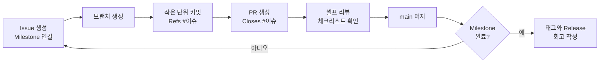

# 작업 방식

이 저장소는 혼자 진행하더라도 팀 프로젝트처럼 **이슈 → 브랜치 → 커밋 → PR → 머지 → 릴리스** 흐름을 지킵니다. 목적은 계획, 진행, 결과, 회고가 모두 서로 연결된 기록으로 남는 것입니다.

## 1. 전체 흐름



## 2. Milestone

산출물 하나가 Milestone 하나입니다. 이슈는 반드시 Milestone에 연결합니다.

| Milestone | 완료 시 태그 |
| --- | --- |
| 01 업무 분석서 | `v0.1.0` |
| 02 기존 솔루션 및 선행 연구 분석서 | `v0.2.0` |
| 03 자동 전조등 요구사항 명세서 | `v0.3.0` |
| 04 설계·코드·시험 기준 데이터셋 | `v0.4.0` |
| 05 플랫폼 요구사항 명세서 | `v0.5.0` |
| 06 데이터 모델 및 시스템 아키텍처 | `v0.6.0` |
| 07 변경 시나리오 및 Gold Dataset | `v0.7.0` |
| 08 MVP 구현 | `v0.8.0` |
| 09 AI 적용 효과 검증 보고서 | `v0.9.0` |
| 10 통합 및 확장 계획서 | `v1.0.0` |

중간 수정 릴리스가 필요하면 `v0.1.1`처럼 세 번째 자리를 올립니다.

## 3. 이슈

- 하루 안에 끝낼 수 있는 크기로 나눕니다. 그보다 크면 상위 이슈 아래 체크리스트로 쪼갭니다.
- 템플릿: `작업`, `결함`, `결정`(ADR로 이어질 논의).
- 라벨: `type:*` 하나 + `area:*` 하나 이상.
- 진행 상태는 GitHub Projects 보드(Todo / In Progress / Done)로 관리합니다.

## 4. 브랜치

`main`은 항상 완성된 상태만 둡니다. 모든 작업은 브랜치에서 하고 PR로 머지합니다.

| 접두사 | 용도 | 예시 |
| --- | --- | --- |
| `docs/` | 산출물 문서 | `docs/02-related-work` |
| `feat/` | 기능 구현 | `feat/trace-graph` |
| `fix/` | 결함 수정 | `fix/stale-check-commit-sha` |
| `data/` | 데이터셋 구축 | `data/headlamp-requirements` |
| `exp/` | 실험 실행 | `exp/b0-graph-baseline` |
| `chore/` | 설정, CI, 저장소 관리 | `chore/markdown-lint` |

## 5. 커밋 메시지

[Conventional Commits](https://www.conventionalcommits.org/ko/v1.0.0/) 형식을 따릅니다. `git config commit.template .gitmessage`로 템플릿을 등록해 두면 편합니다.

```text
<type>(<scope>): <무엇을 했는지, 50자 이내>

<왜 했는지, 무엇이 달라졌는지. 72자에서 줄바꿈>

Refs #12
```

| type | 의미 |
| --- | --- |
| `docs` | 문서 추가, 수정 |
| `feat` | 기능 추가 |
| `fix` | 결함 수정 |
| `test` | 시험 코드 추가, 수정 |
| `refactor` | 동작 변화 없는 구조 개선 |
| `data` | 데이터셋, Gold 라벨 추가, 수정 |
| `exp` | 실험 설정, 실행 결과 기록 |
| `chore` | 설정, 빌드, CI, 저장소 관리 |

scope 예시: `analysis`, `related-work`, `spec`, `dataset`, `core`, `trace`, `change`, `verify`, `eval`, `adr`, `retro`.

**좋은 커밋의 기준**

- 한 커밋에는 하나의 논리적 변경만 담습니다. "문서 수정 + 코드 수정 + 오탈자"를 한 번에 커밋하지 않습니다.
- 커밋 하나만 되돌려도 저장소가 깨지지 않아야 합니다.
- 본문에는 "무엇을"보다 "왜"를 씁니다. 무엇을 바꿨는지는 diff가 보여줍니다.

**예시**

```text
docs(analysis): SWE.1~SWE.6 업무 정의 표 추가

ASPICE PAM v4.0 원문 BP 제목 기준으로 21개 세부 업무를 정의함.
모든 SWE 프로세스에 정합성·추적 BP가 있다는 점을 MVP 근거로 사용.

Refs #3
```

```text
exp(eval): B0 그래프 탐색 기준선 실행 결과 기록

링크 누락률 0/25/50%, seed 5개 조건. 결과는 eval/results/b0/에 저장.

Refs #41
```

## 6. Pull Request

- 혼자 진행해도 PR을 만들고, 템플릿의 체크리스트로 셀프 리뷰합니다.
- 본문에 `Closes #이슈번호`를 적어 머지 시 이슈가 자동으로 닫히게 합니다.
- 머지 방식은 **Create a merge commit**을 사용해 개별 커밋 기록을 보존합니다.
- `main` 브랜치 보호 규칙: PR 필수, CI 통과 필수.

## 7. 산출물 문서 동기화

초안은 Claude Docs 등 편집 도구에서 작성할 수 있지만, **확정된 순간부터 원본은 이 저장소**입니다.

1. 초안 작성
2. Markdown으로 내보내 `docs/NN-*.md`로 커밋 (PR)
3. 이후 수정은 저장소에서만 하고 PR로 반영
4. 문서 맨 위의 `문서 버전`을 함께 올림

## 8. 결정 기록 (ADR)

방향이 바뀌거나 대안 중 하나를 고른 경우 `decisions/`에 ADR을 남깁니다. 기준: 나중에 "왜 이렇게 했지?"라는 질문이 나올 만한 결정. 템플릿은 [decisions/0000-template.md](../decisions/0000-template.md).

## 9. 회고

Milestone을 닫을 때마다 `retrospectives/NN-*.md`를 작성하고 Release 노트에 링크합니다. 템플릿은 [retrospectives/template.md](../retrospectives/template.md). 프로젝트 종료 후 블로그 글은 이 회고들을 바탕으로 작성합니다.

## 10. 공개 저장소 주의 사항

- 현업 인터뷰 내용은 답변자가 동의한 범위만, 회사명과 개인 정보를 제거하고 기록합니다.
- API 키 등 비밀 값은 커밋하지 않습니다(`.env`는 `.gitignore`에 포함).
- 차량 사양은 모두 가상 사양임을 명시합니다.
